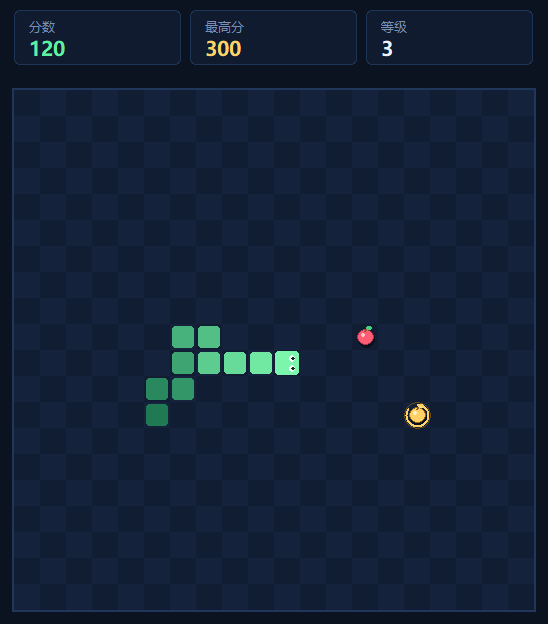

# 贪吃蛇 · Snake

一个用 Python + tkinter 写的单文件小游戏，**不需要安装任何第三方库**。



## 运行

需要 Python 3.8 或更高版本（Windows 官方 Python 自带 tkinter）：

```bash
python snake_game.py
```

也可以直接双击 `snake_game.py`（前提是 `.py` 已关联到 Python）。

## 操作

| 按键 | 作用 |
| --- | --- |
| `↑` `↓` `←` `→` / `W` `A` `S` `D` | 控制方向 |
| `空格` / `回车` | 开始、暂停、继续 |
| `R` | 重新开始 |
| `Esc` | 退出游戏 |

## 规则

- 吃掉红苹果加 **10 分**，每吃 5 个苹果提升一级，移动速度加快。
- 每吃 5 个苹果会刷出一颗**金苹果**，限时 7 秒，吃到加 **50 分**。
- 撞到墙壁或咬到自己的身体，游戏结束。
- 最高分会自动保存在脚本旁边的 `snake_highscore.json` 中。

## 自检

不打开窗口，只运行游戏逻辑测试：

```bash
python snake_game.py --selftest
```

## 说明

- 暂停时金苹果倒计时会一并冻结。
- 如果系统提示找不到 `tkinter`，Linux 可安装 `python3-tk`；Windows 建议使用 python.org 的官方安装包并勾选 “tcl/tk and IDLE”。
